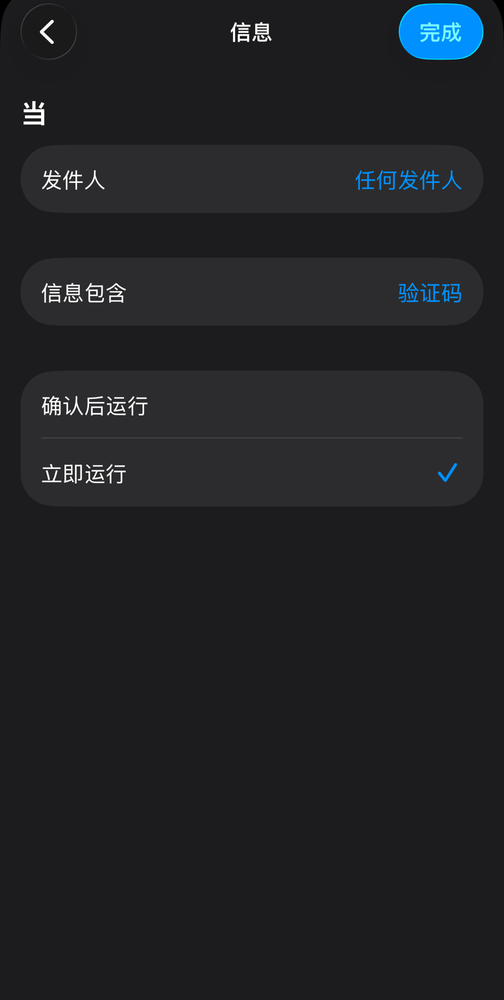
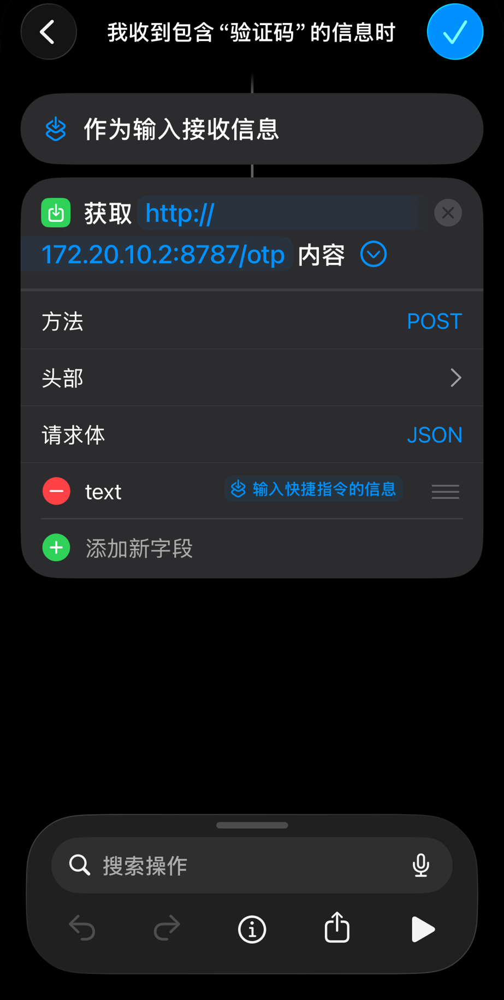
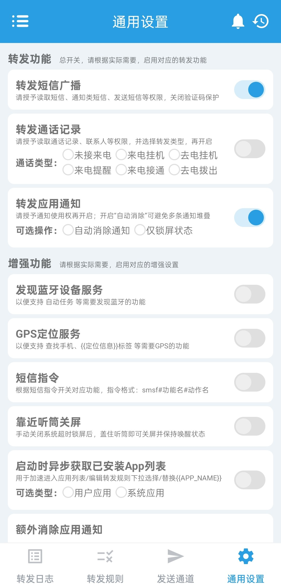
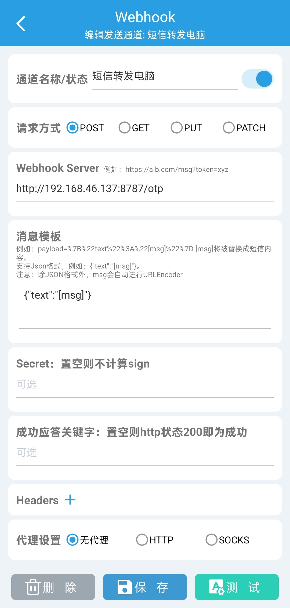
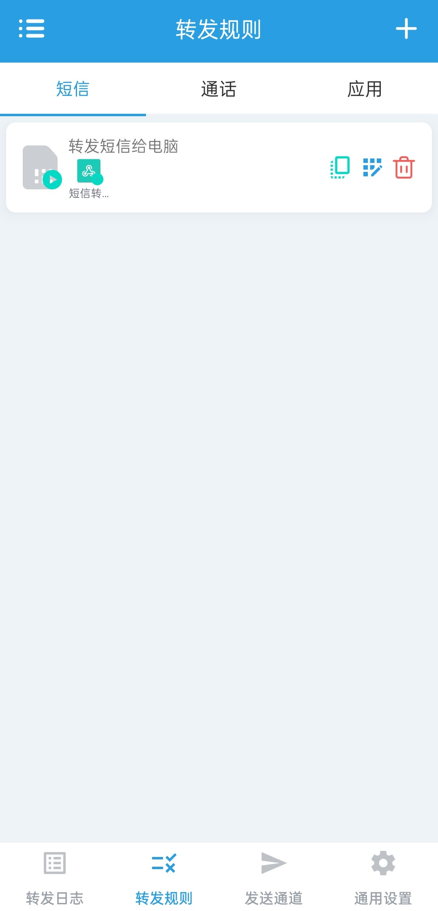
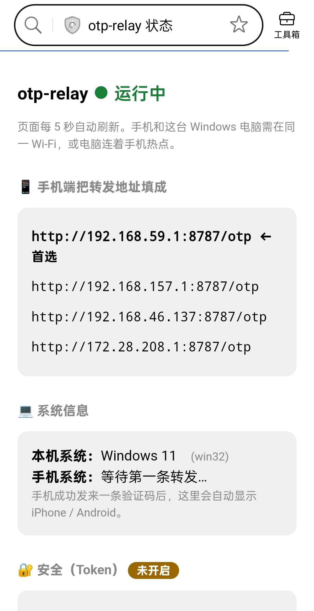
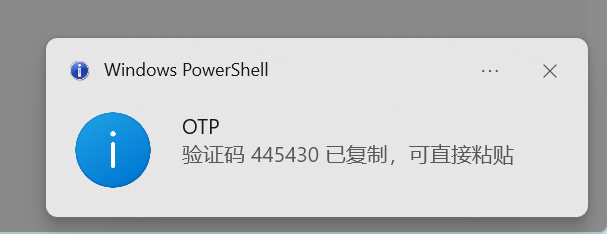

# otp-relay — 手机验证码自动到电脑剪贴板

投简历/登录时不用再"掏手机 → 看短信 → 手抄验证码"。
手机收到验证码短信后自动转发到本机，抠出验证码、**写入电脑剪贴板并弹通知**，你在网页里粘贴（Mac `Cmd+V` / Windows `Ctrl+V`）即可。

**支持 macOS 和 Windows**（同一份代码，按平台自动适配剪贴板/通知/自启）。

## 它是怎么工作的

```
手机（收到含"验证码"的短信）
   │  POST http://<电脑的IP>:8787/otp   body: 短信原文
   ▼
同一个 Wi-Fi / 手机热点（局域网直连，无需公网、无需 VPN）
   ▼
电脑上的 otp_server.py（监听 8787，路由 /otp）
   │  以"验证码/code"为锚抠出 4-8 位数字 → 写剪贴板 + 弹通知
   ▼
你在网页里粘贴（Cmd+V / Ctrl+V）
```

- **不改机器人自动投递**，只是半自动：省掉"掏手机看码抄码"，保留你手动粘贴。
- **零依赖**：只用系统自带能力——Mac 用 `python3`/`pbcopy`/`osascript`，Windows 用 `python`/`clip`/PowerShell。

---

## 启动服务

**macOS**：

```bash
cd otp-relay
./start.sh
```

**Windows**：双击 `start.cmd`，或在 cmd/PowerShell 里运行它（需先装 Python 3 并勾选 "Add to PATH"）。Windows 的手机该填 IP 在状态页 <http://localhost:8787/> 顶部会列出。

以下以 macOS 为例，Windows 除了启动方式和粘贴键（`Ctrl+V`）外完全一致：

```bash
cd otp-relay
./start.sh
```

`start.sh` 会**自动探测本机 IP**，并打印出"手机该填的 URL"，例如：

```
📱 在手机上把转发地址填成：
        http://192.168.1.23:8787/otp
```

把这个 URL 记下来，配到手机端（见下）。窗口别关，服务要一直开着。

> 换网络后 Mac 的 IP 会变，重跑 `./start.sh` 拿到新地址、更新手机端即可。

### 状态 / 配置页

服务起来后，在**这台 Mac 的浏览器**打开 <http://localhost:8787/>，能看到一个每 5 秒自动刷新的页面：

- **手机该填的 URL**（自动列出所有本机 IP，首选置顶）
- **Token 开关**：直接在页面上填一串口令保存即可开启校验（详见下方"安全"）
- **最近活动**：最近收到的请求、命中/忽略，**验证码脱敏显示**（如 `1••••0`）

手机浏览器也能打开 `http://<Mac的IP>:8787/` 看状态确认连通，但**改 token、开关服务、设置自启都只能在 Mac 本机操作**。

页面上的"服务控制"卡片（仅本机可见操作）：

- **登录自启开关**：一键写入/删除 LaunchAgent（`~/Library/LaunchAgents/com.otp-relay.local.plist`），开启后每次登录 Mac 自动后台启动，日志落到 `otp-relay.log`。
- **停止服务器**：点了即退出进程。⚠️ 由于网页是服务器自己托管的，**停止后本页失效，只能回到 Mac 用 `./start.sh`（或靠登录自启）重新拉起**——这是单向操作。

---

## 手机端

手机侧只当"哑巴转发器"：**收到含"验证码"的短信 → 把原文 POST 到上面那个 URL**。抠码逻辑全在 Mac，手机不用管。

### iPhone（快捷指令，iOS 16+）

1. 快捷指令 App → **自动化** → **＋** → 新建自动化
2. 触发选 **信息**：发件人=任何人，信息**包含** `验证码`，运行方式=**立即运行**（关掉"运行前询问"）
3. 加动作 **获取 URL 内容**：
   - URL：`http://<Mac的IP>:8787/otp`
   - 展开"显示更多"：方法 **POST**，请求体 **JSON**，加字段 `text` = 变量「**快捷指令输入**」（即短信正文）
4. 保存

配置截图示例（左：触发条件；右：POST 动作）：

| 触发条件 | POST 动作 |
|---|---|
|  |  |

### Android（短信转发 App）

安卓端需要同时配置**发送通道**和**转发规则**。只安装 App、打开短信监听开关，不会自动把短信发到电脑。

推荐开源免费的 **SmsForwarder（短信转发器）**，也可以使用 **MacroDroid**。

- GitHub 项目地址：<https://github.com/pppscn/SmsForwarder>
- APK 下载：<https://github.com/pppscn/SmsForwarder/releases>

从 Release 下载 APK 时，近年的 Android 真机通常选择 `arm64-v8a`；不确定架构时选择 `universal`。不要下载 `x86`/`x86_64`（模拟器架构）或 Source code。

#### Android + Windows 实测配置（2026-10-17）

以下组合已完成真实短信全链路测试：

- Windows 11 + Python 3.12.6
- OPPO Find X7 / ColorOS
- SmsForwarder 3.5.0（`arm64-v8a`）
- 拼多多验证码短信 → Webhook → `[HIT]` → Windows 通知 → 剪贴板

1. **启动 Windows 服务**

   在 PowerShell 中运行：

   ```powershell
   cd D:\GOfiles\Agent\otp-relay
   .\start.cmd
   ```

   看到下面三行就代表启动成功，窗口需要保持开启：

   ```text
   otp-relay 已启动：http://localhost:8787/
   手机端 POST 目标：http://<本机IP>:8787/otp
   Token 校验：关闭。按 Ctrl+C 停止。
   ```

   某些 Windows 终端会把 `start.cmd` 前面的中文提示显示成乱码，甚至出现提示行“不是内部或外部命令”；只要最后出现上面三行，Python 服务就已经正常运行。

2. **确认手机可以连接电脑**

   在 Windows 运行 `ipconfig`，使用 **WLAN** 网卡下的 IPv4 地址。不要误用 VMware、WSL、Hyper-V 等虚拟网卡地址。

   手机与电脑连接同一 Wi-Fi，然后用手机浏览器打开：

   ```text
   http://<Windows的WLAN-IP>:8787/
   ```

   能看到 `otp-relay ● 运行中` 才继续。如果打不开，检查 Windows 防火墙是否允许 Python 访问“专用网络”。

3. **安装并授权 SmsForwarder**

   安装后授予短信读取/接收权限。OPPO/ColorOS 可以长按桌面的“短信转发器”图标 → **应用信息**，允许短信权限、后台活动和自启动，并关闭该 App 的电池优化。

   如果普通短信可以转发、验证码短信却完全收不到，检查系统短信 App 的 **设置 → 隐私保护 → 验证码安全保护**。关闭该保护会降低短信隐私安全，只在确认 ColorOS 确实拦截验证码、且设备为本人使用时考虑关闭。

4. **创建发送通道**

   SmsForwarder → **发送通道** → 新增 → 类型选择 **Webhook**（不是 URL Scheme，也不是 Socket）：

   ```text
   名称：电脑验证码
   WebHook 地址：http://<Windows的WLAN-IP>:8787/otp
   请求方式：POST
   消息模板：{"text":"[msg]"}
   Header：Token 未开启时留空
   Secret：留空
   ```

   SmsForwarder 3.5.0 使用“消息模板”这个名称；旧版本如果显示 `WebParams` 或“请求参数”，就在对应输入框填写同一段 JSON。留空并使用 App 默认的表单请求通常也能工作，因为服务端会从整个请求体中寻找短信正文。

   保存后点击通道的**测试**。默认测试文本没有验证码时，电脑终端显示 `[skip] no code` 也代表 Webhook 已打通。要明确测试剪贴板，可以临时把“消息模板”改成：

   ```json
   {"text":"验证码 123456"}
   ```

   此时终端应显示 `[HIT] code=123456`，测试后再恢复为 `{"text":"[msg]"}`。

5. **创建转发规则**

   SmsForwarder → **转发规则** → 新增：

   ```text
   消息类型：短信
   匹配字段：短信内容
   匹配方式：包含
   匹配值：验证码
   发送通道：电脑验证码
   ```

   保存并确认规则已启用。若需要兼容其他短信，可分别增加 `动态码`、`校验码`、`code`、`OTP` 等规则。不建议“转发全部短信”，否则普通私人短信也会被发送到电脑。

6. **验证真实短信**

   收到验证码短信后，Windows 终端应出现：

   ```text
   [HIT] code=445430  <- '……验证码为445430……'
   ```

   随后 Windows 弹出通知，验证码进入剪贴板，可直接 `Ctrl+V`。如果为了反馈问题而复制终端日志，会覆盖刚写入的验证码；请先在记事本中粘贴验证，或用 `Get-Clipboard`/`Win+V` 检查。

MacroDroid 方案：触发器=**收到短信** → 动作=**HTTP Request**（POST，URL 同上，Body 放短信内容变量），可加“内容包含 验证码”的约束。

| 通用设置                                 | 发送通道 |
|--------------------------------------|---|
|  |  |

| 转发规则 | 手机浏览器查看运行状态 |
|---|---|
|  |  |



---

## 验证是否打通（分层排查）

1. **电脑自测**：服务启动后，`curl http://127.0.0.1:8787/otp -d '{"text":"验证码 123456"}'`，剪贴板应变成 `123456`。
2. **网络自测**：手机浏览器打开 `http://<电脑的IP>:8787/`，看到状态页 = 手机能连到电脑。
3. **通道自测**：Android 在 Webhook 通道点“测试”；终端出现 `[skip]` 或 `[HIT]` = 通道能连到电脑。
4. **全链路**：收到一条真实验证码短信 → 终端打印 `[HIT] code=...` + 弹通知 + 剪贴板就位。

## 常见问题

| 现象 | 原因 / 解决 |
|---|---|
| 看不到日志、收不到码 | 服务没在跑（`lsof -iTCP:8787` 查），或手机 URL 的 IP 过时了（重跑 `start.sh`） |
| 手机 Safari 打不开健康页 | 手机和 Mac 不在同一网络；或用了热点但开了客户端隔离 → 改连同一个普通 Wi-Fi |
| 返回 404 | URL 把 `/otp` 写成了 `/opt` |
| 抠到的是手机尾号/订单号 | 已按"关键词为锚"修复；若仍误抓，把样例短信发我调规则 |
| 码对了但没弹通知 | 系统设置→通知里放行终端/脚本（不影响剪贴板，Cmd+V 照用） |
| 英文验证码不触发 | 第一版触发词只配了"验证码"；再建一条触发词 `code` 的自动化 |
| 安卓锁屏后收不到/不转发 | 转发 App 被系统后台省电杀了 → 系统设置里关掉它的电池优化、允许后台常驻/自启动 |
| Android 状态页的手机信息一直为空 | 手机从未向服务发出请求；先创建 Webhook 发送通道，再创建并启用转发规则 |
| Webhook 测试显示 `[skip] no code` | 请求已经成功到达；只是测试文本没有“验证码/code”和 4-8 位数字，不是网络错误 |
| Windows 状态页列出多个 IP | 用 `ipconfig` 找 **WLAN** 的 IPv4；忽略 VMware、WSL、Hyper-V 等虚拟网卡地址 |
| Windows 弹通知但粘贴不到验证码 | 不要先复制终端日志，它会覆盖验证码；立即在记事本 `Ctrl+V`，或运行 `Get-Clipboard` 检查 |

## 安全说明

**这个 HTTP 接口谁能调用？**

- **公网陌生人调不到**：服务只监听局域网私有 IP（`192.168.x.x` / `172.20.10.x`），没有做端口转发，互联网上碰不到。
- **同一 Wi-Fi/热点的设备理论上能访问**。但即便如此：
  - 服务**不存储、也没有任何"读取验证码"的接口**——最近活动在状态页上也是**脱敏**的（`1••••0`）。攻击者**偷不到你的真实码**。
  - 他最多能"往里塞"一条假短信污染你剪贴板。**风险是被投毒/骚扰，不是被窃取。**

**加固（按性价比）：**

1. **开启 Token（最有效）**：在 Mac 本机浏览器打开 <http://localhost:8787/>，在"安全"卡片里填一串随机口令保存。之后所有 POST 必须带头部 `X-Token: 该值`，否则 401 拒绝。
   - iPhone 快捷指令：在"获取 URL 内容"的**头部**里加 `X-Token` = 你的口令。
   - Android 转发 App：在 Webhook 的 Header 里加 `X-Token`。
   - 口令存在本地 `config.json`（已 gitignore，不进仓库）；**改 token 只能在 Mac 本机操作**，同网段的人改不了。
2. **用完关掉服务**，缩短暴露窗口。
3. **优先连自己的手机热点**，把局域网范围缩到就你俩设备。

## 配置项

- 网页配置：<http://localhost:8787/> 可开关 Token（推荐）
- 代码顶部（`otp_server.py`）：`PORT` 端口、`KEYWORDS` 命中关键词列表
- `config.json`：存 token，自动生成，已 gitignore

## 待办（TODO）

- [x] 开机自启 —— 已支持，网页一键开关（Mac: LaunchAgent / Windows: 启动文件夹）
- [x] 网页控制服务停止 —— 已支持（单向，重开靠 start 脚本/自启）
- [x] Windows 支持 —— 已支持（剪贴板/通知/本机IP/自启按平台自动适配）
- [ ] 英文验证码：加一条 `code` 触发的自动化
- [ ] 地址永不变：iPhone 若能切非中国区 App Store，则上 Tailscale，一个地址通吃所有网络
- [ ] 真·自动填入（免 Cmd+V）：辅助功能权限 + 模拟键盘，处理分格输入框
- [ ] 路 A 第二后端：Mac 登 Apple ID + 读 `~/Library/Messages/chat.db`
